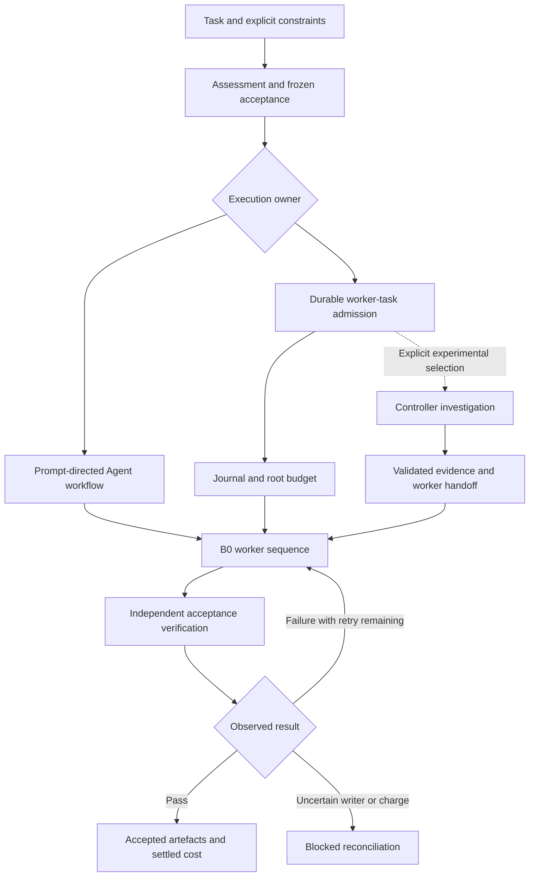

# Orchestrator project assessment

Date: 2026-10-13, Australia/Sydney. Scope: the full project directory, selected
by the operator. Starting revision: `82a077a`; initial working tree clean.
Perspectives: engineering, architecture, AI research, UI/UX and Apps.

## Executive judgement

The useful product is a locally installed, verifiable task-execution workflow
for Claude Code: a conservative worker sequence, explicit acceptance, durable
accounting and recoverable state. The repository also contains a much larger
experimental programme for routing and multi-role investigation.

Keep B0 as the default. The recorded evidence does not justify promoting
Controller or advertising general cost savings. Prioritise reliable measurement,
retrieval and a simpler operator experience before expanding autonomy or adding
cloud infrastructure. The accepted O0-O6 plan already addresses the most serious
research prerequisites; implement that plan rather than inventing another one.

This is a source- and evidence-based assessment with local verification, not a
new live model comparison, exhaustive security audit or independent promotion
review. Historical results retain their original populations, hosts and limits.

## 1. Deliverables

| Deliverable | What the user receives | Source and boundary |
| :--- | :--- | :--- |
| Installable bundle | Instructions, worker definitions, commands, Python tools, schemas and installation support | `src/` and selected `tools/` assembled into `dist/` by the checked builder |
| Worker policy | B0: Sonnet low, one same-cell repair after observable failure, then one Opus-high fallback; stop on verified success | `src/ORCHESTRATOR_CORE.md`, `tools/route.py`, `tools/task_executor.py` |
| Worker catalogue | Fifteen model/effort combinations plus a separate Haiku provider-default worker | `src/model_registry.json`, generated worker definitions; catalogue size is not automatic routing breadth |
| Durable task workflow | Admission, budget reservation, execution, verification, cancellation, reconciliation and continuation | `tools/worker_tasks.py`, `tools/task_executor.py`, `src/WORKER-TASKS.md` |
| Experimental Controller | Budgeted framing, verification, generation, critique and selection, with a validated handoff | `tools/system_controller.py`, `tools/controller_dispatch.py`, `src/System/`, `src/CONTROLLER.md` |
| Evidence and qualification | Offline harness, fixtures, protected evaluators, frozen campaigns, receipts and promotion decisions | `test/`, research tools and dated stage results |
| Development continuity | Model calibration, operator preferences, concise handoffs, source/generated boundaries and live status | `AGENTS.md`, `CLAUDE.md`, the development calibration and current status |

The bundle is configuration, prose and executable tools for a local Claude Code
host. The inspected architecture does not constitute a deployed cloud service,
mobile app or general multi-provider orchestration platform. Codex model choices
in development are separate from the Anthropic worker registry shipped to users.

The source repository and consumer package have different needs. Research
history belongs in the source repository. A consumer needs a small operating
contract, installation instructions, clear diagnostics and reliable recovery.

## 2. How it works

The task assessment records sensitivity, horizon and consequences, but the
shipping resolver does not use them to select a more expensive first worker.
History supports diagnostics; it cannot silently change B0. This distinction is
central to the product's actual behaviour.

There are two execution surfaces. Ordinary Agent-tool delegation depends on the
session following the operating prompt. The durable CLI owns an admitted root
and explicitly enforces its state and budget. It does not intercept arbitrary
Agent launches. Mixing owners for the same work risks duplicate execution; the
consumer guide explicitly tells operators to choose one.

The durable executor freezes acceptance and source identity, journals state
transitions, reserves a maximum before dispatch and records receipts before
settlement. Its `run` path treats a surviving intent without a complete receipt
as uncertain, rather than automatically retrying it. Receipt identity and writer
termination matter as well as an apparent answer. Review-based acceptance stays
separate from executable acceptance. This makes uncertainty visible instead of
equating silence with success or zero cost.

Controller adds a multi-role investigation and structured evidence. Its output
must preserve external acceptance and pass handoff validation before a worker
continues. That additional mechanism can run successfully without improving task
outcomes. Execution, identity, useful investigation and economic value are
separate claims.

The builder assembles an operating core and a detailed reference, strips marked
rationale from the reference and creates a manifest. It runs the offline harness
before replacing `dist/`, allowing only its narrowly defined pre-build parity
exceptions. Installation has ownership and backup records. The historical frozen
release archive and a newly generated working bundle are different artefacts.

## 3. Assessment

### Strengths supported by inspected evidence

- **Honest policy selection.** Negative results were retained and the simpler
  baseline survived. The project did not promote a more elaborate mechanism
  merely because it was implemented.
- **Explicit execution state.** The inspected executor separates admission,
  dispatch, receipt, verification and reconciliation. Stable invocation records
  and uncertain states address real crash windows.
- **Acceptance is external to the worker's claim.** Protected paths, output
  requirements, executable checks and review states reduce false completion.
- **Useful release boundaries.** Source and generated output are distinct;
  builds and install lifecycle checks have recorded evidence.
- **Continuity is already designed.** Calibration, a handoff helper, validation
  and evidence records exist. This task extends those mechanisms instead of
  adding a competing model policy.

### Findings and their implications

| Priority | Observation | Assessment and recommended response |
| :--- | :--- | :--- |
| P0 for new research | The historical H03 admission function still compares raw receipt cost with rounded ledger spend using exact equality | The known boundary can reject eligible work. Implement canonical comparison in the successor research path with genuine mismatch controls; preserve closed historical entry points |
| P0 for new research | H03b's frozen private grader raised an exception, so its score is unavailable | A completed worker call is insufficient measurement. O1 must distinguish candidate failure from evaluator failure and qualify malformed, exceptional and timed-out cases |
| P0 for broad autonomy claims | The consumer guide reports unproven general filesystem confinement and rejects live managed children | Offline state-machine tests do not establish host containment. Keep claims scoped; qualify the actual host before enabling broader child execution |
| P1 | Graft MCP freshness, map and file-API calls exceeded 180 seconds in this session; equivalent CLI retrieval worked | Required retrieval currently has a material availability cost. Diagnose refresh/index scope and latency, then verify fresh-session MCP access. CLI recovery is not proof that the MCP connection is repaired |
| P1 | Graft CLI freshness reported changed source and large missing semantic coverage | Distinguish structural lookup from stale meanings. Use exact source to verify important findings; do not spend on an unchanged failed semantic-refresh request |
| P1 | CLAUDE.md embeds a long sequence of closed experiments before current operational guidance | Stale status and repeated history increase startup work and make the active stage harder to identify. Keep standing rules short and use one current-status pointer plus an evidence index |
| P1 | Durable and prompt-directed execution expose different guarantees | A unified status and next-action explanation would reduce operator mistakes. Label ownership, proof scope and unresolved funds clearly |
| P2 | The executor and Controller contain large interacting methods, alongside many historical research variants | Maintenance risk is concentrated at state/identity/budget boundaries. Extract pure validators only after behaviour is pinned by counterexamples; avoid a wholesale rewrite |
| P2 | Cost/quality comparisons are highly task- and host-specific | Measure cost per accepted task including screening, retries, review and unresolved charges; do not generalise token prices or a small fixture set into product savings |

The Graft snapshot described 2,461 indexed files, including 1,639 fixture files,
420 result files, 225 tools and 120 harness files. These are index counts, not
authored-code counts. Their composition explains why an unscoped orientation
is dominated by evaluation material. It suggests a retrieval-scope improvement;
it does not prove the cause of the timeout.

No general financial value claim follows from the existing safety mechanisms.
Reduced undetected errors is a plausible product benefit, but its magnitude and
users' willingness to pay remain unmeasured. My product judgement is that
reliable, understandable execution is the stronger near-term proposition.

### UI/UX and Apps perspective

The primary interface today is a CLI plus agent instructions. Polish that
interface before building a dashboard. A normal status view should answer:
what owns this task, what happened, what was verified, what remains uncertain,
what it cost, and exactly what can happen next.

Use progressive disclosure: a concise normal view and structured JSON for
advanced inspection. Present spent, reserved and unresolved amounts separately;
distinguish requested effort from observed identity; attach the failed check and
recovery command to a blocked state. Use explicit state words as well as colour.
Validate usability with install-to-first-verified-task time and recovery errors.
These are proposed measurements, not observed usability defects or adoption data.

There is no evidence-based reason to add cloud services now. A future hosted
version would need tenancy, authentication, secrets, durable coordination,
isolation, quotas and operational ownership. Those requirements would materially
change the trust boundary and cost model. Keep that a separate product decision.

## 4. Current status

| Area | Status at the reviewed starting revision |
| :--- | :--- |
| Release baseline | Recorded `2026-10-02-f9f141c` archive, historically 83/83 offline checks and 85-file install/upgrade/rollback/reproducibility evidence |
| Publication | Still described as an operator action; no publication proof obtained in this assessment |
| Default policy | B0 retained; no promoted adaptive or Controller default |
| Controller benefit | Not established |
| Latest accepted engineering programme | O0-O6 offline qualification plan and initial handoff prepared; no implementation delivered by the latest commit, which changes instructions, README and generated guidance |
| Development selection | DMC-1 remains authoritative; host schemas expose the required Luna, Sol 6.1 and Astra settings, without this task proving execution of every setting |
| Current assessment | Preferences and source guidance updated; final verification results are recorded below |

In the [X5 v7 record](stage-results/controller-x5-v7-result-2026-09-29.md),
four suitable task pairs passed protected functionality in B, S and A. A had no
measured quality or acceptance gain, cost 2.67 times S and took 1.84 times its
mean elapsed time. The first six related v6 episodes had measurement defects
and later diagnostic regrading. This is development evidence, not independent
confirmation or a general estimate of Controller performance.

The [post-RC reconciliation](POST-RC-QUALIFICATION-ANALYSIS-2026-10-02.md)
records the older reserved comparison at B0 12/24 accepted versus B1 10/24,
with two B0 paired wins and none for B1. Those are historical fixture outcomes,
not current production acceptance rates. Closed campaigns and unavailable
historical scores must stay closed and unchanged.

## 5. Improvements and stage order

Model selection remains owned by [DMC-1](DEVELOPMENT-MODEL-CALIBRATION.md).
The settings below are dated task assignments derived from its rows, not new
defaults or measured model-performance rankings. Refresh the snapshot before
launch. No stage in this assessment has been launched merely by listing it.

| Order | Proposed work and exit gate | Model and effort snapshot | Blast radius and planning time |
| :--- | :--- | :--- | :--- |
| 1 | Restore reliable Graft MCP retrieval and reduce startup-history duplication; verify freshness and a scoped source query in a fresh session | Sol 6.1 / High, C3 for diagnosis; Luna / Medium, C1 for prescribed documentation cleanup | Local retrieval configuration and instruction entry points; 1-3 hours |
| 2: O0 | Freeze successor research contracts, threat boundary, acceptance matrix and ownership | Sol 6.1 / High, O0/C3 | New research contract; 45-90 minutes |
| 3: O1 | Bound evaluator outcomes and qualify independent negative controls | Sol 6.1 / High, O1/C3 | Research evaluator and isolation boundary; 2-4 hours |
| 4: O2 | Canonical cost admission, both public entry branches and identical public feedback | Luna / High, O2/C2 | New admission/packet components; 1.5-3 hours |
| 5: O3 | Campaign-local identity proof, freshness and source preflight | Luna / High, O3/C2 | Research preflight and identity schema; 1.5-3 hours |
| 6: O4 | Integrate fake campaigns, source seals and interruption/recovery; prove zero provider fallback | Sol 6.1 / Extra high, O4/C4 | Shared runner integration; 1.5-3 hours |
| 7: O5 | Fresh-context adversarial review with independently derived counterexamples and verified finding closure | Sol 6.1 / Extra high, O5/C4 | Review and required repairs; 1-2 hours |
| 8: O6 | Assemble reviewed evidence and separate offline-qualified from live-launch-ready | Luna / Medium, O6/C1 | Runbook and dossier; 30-60 minutes |
| 9 | Simplify CLI onboarding/status/recovery using the existing capability and task records; verify representative operator journeys | Sol 6.1 / High, C3 for contract; Luna / High, C2 for frozen presentation rules | Consumer CLI/docs and installed regression; 3-6 hours |
| 10 | Reduce repeated validators and large-method coupling in the most changed runtime seam, with behaviour-preserving negative controls | Sol 6.1 / High, C3; C4 review if interacting state machines change | One module boundary at a time; 3-6 hours per selected seam |
| Conditional | New bounded feasibility, fair comparison with simpler extra compute, then independent confirmation and whole-policy evaluation only if warranted | C3/C4 according to the question; explicit Astra C5/C6 escalation only after documented failures | New experiment source, hosts and budgets; estimate from its frozen protocol |

The O stages retain the [accepted implementation plan](OFFLINE-QUALIFICATION-IMPLEMENTATION-PLAN-2026-10-02.md)
and its requirements. O1-O3 may overlap only after O0 freezes interfaces and
disjoint ownership. O4 and O5 follow completed prerequisites. Autonomy changes
who performs a necessary transition, not the acceptance gates.

Do not make all future improvements prerequisites for publishing a correctly
scoped B0 release. Measurement work gates new comparative research. Broader
host qualification gates broader host claims. Product usability and maintainability
can progress without proving Controller uplift. This separation avoids making
the release depend on an experiment producing a positive result.

### Cost and time assumptions

Official pages checked 2026-10-13 list Standard short-context API rates per
million tokens as follows. These are direct API equivalents, not desktop bills.

| Model | Input | Cache read | Cache write | Output, including billed reasoning |
| :--- | ---: | ---: | ---: | ---: |
| GPT-6 Luna | USD 0.10 | USD 0.01 | USD 0.125 | USD 0.50 |
| GPT-6.1 Sol | USD 2.00 | USD 0.10 | USD 2.50 | USD 10.00 |
| GPT-6 Astra | USD 10.00 | USD 1.00 | USD 12.50 | USD 50.00 |

Sources: [official comparison](https://developers.openai.com/api/docs/models/compare)
and [Sol specification](https://developers.openai.com/api/docs/models/gpt-6.1-sol).
The [selection guide](https://developers.openai.com/api/docs/guides/model-selection)
supports task-specific comparison; it does not establish this project's realised
quality, latency or savings.

For each O stage, reuse the plan's illustrative 100K-300K cache-write input,
200K-1M cache-read input and 20K-80K output tokens across multiple requests.
Categories are disjoint; no request exceeds 272K input tokens. This gives
USD 0.0245-0.0875 per Luna stage, USD 0.47-1.65 per Sol stage and
USD 2.45-8.75 for a targeted Astra stage, before retries.

Four Sol and three Luna O stages total about USD 1.95-6.86 at Standard rates.
Allowing 25 percent extra usage and Fast pricing doubles the rate and gives an
upper scenario near USD 17.15. With no cache reuse and conservative cache-write
charging for all input, that upper scenario rises to USD 42.02. These are
arithmetic scenarios, not spending caps or measured session costs. Unbounded
rework, long contexts, other paid tools and live experiments are excluded.
Reprice each actual handoff rather than treating this estimate as authority.

The existing O0-O6 sequence totals 8.75-17.5 active hours, before major redesign
and external waits. Clean O1-O3 overlap suggests roughly 6-13 elapsed hours with
coordination. Confidence is low until executed stages supply measurements.
Retrieval/cleanup and later UX/refactoring allowances are additional. Lower
token prices do not demonstrate a shorter schedule.

No new experimental provider calls are included in this assessment or the
offline O plan. The current development session's billable token telemetry is
unavailable. Its actual API-equivalent cost must therefore remain unknown.

## 6. Changes made and verification record

This task persisted [operator preferences](OPERATOR-PREFERENCES.md), connected
them and [live status](PROJECT-STATUS.md) to both startup files, and extended
consumer source guidance with UI/UX and Apps perspectives, scoped autonomy,
commits at handoff, kickoff prompts, blast-radius explanations and live status.
The routing policy, provider mappings, runtime Python and historical evidence
were not edited.

The checked build passed on the normal host with Python 3.12.14 and regenerated
the working bundle as `2026-10-13-82a077a-dirty`. It took approximately 24 minutes.
The builder invoked the existing full offline harness and enforced its source
gate, with its documented pre-build parity exceptions. The builder does not
retain the individual full-run counts, so this assessment does not invent a
fresh 83/83 result from its exit code.

The [post-build verification record](../test/results/2026-10-13-project-assessment-verification.json)
records PASS for distribution parity, release mechanical checks, context
contracts and prose. All 85 generated files match planned output; all six
context-contract tests pass; 925 authored files pass the prose check. Release
checks still name clean-build stamping and publication as operator actions.
This working build does not replace or publish the frozen RC.

The [successful build log](../test/results/2026-10-13-project-assessment-build.log)
is retained. The first invocation did not launch because the Windows Store
Python alias failed. A subsequent restricted-shell build stopped when X0
exceeded its existing 60-second timeout; its
[failure log](../test/results/2026-10-13-project-assessment-restricted-build.log)
is preserved. Isolated X0 then passed 6/6 in 11.4 seconds on the normal host,
followed by the successful checked build. No test timeout or acceptance rule
was weakened. A fresh SHA-256 check of the historical RC archive matched
`783861afe26a8b65fa93194d9d3fbcaeedac9bc72278d5c2c1fe4fb3051d63ed`.

Graft MCP timed out at 180 seconds for freshness, map and file API. Diagnostic
checks included unrestricted local freshness, which still found stale semantics.
Equivalent Graft CLI map, skeleton, ask, grep and caller retrieval succeeded;
snapshot queries used `--no-refresh` and important code was checked directly.
MCP recovery is unresolved. No paid deep pass was run. The CLI's whole-file
comparison token estimates are not measurements of session or monetary savings.

### Evidence anchors

- [Consumer operating source](../src/ORCHESTRATOR_CORE.md) and
  [durable task contract](../src/WORKER-TASKS.md).
- [Task executor](../tools/task_executor.py), particularly `run`, receipt
  recovery and independent verification.
- [Historical H03 admission](../tools/controller_x5_h03_pilot.py),
  `accepted_producer`, and [canonical budget implementation](../tools/dispatch_budget.py).
- [Checked builder](../tools/build_dist.py) and [offline harness](../test/harness/check.py).
- [RC identity and archive evidence](stage-results/release-candidate-model-identity-2026-10-02.md),
  [archive verification record](../test/results/2026-10-01-rc/verification.json).
- [Post-RC reconciled evidence](POST-RC-QUALIFICATION-ANALYSIS-2026-10-02.md),
  [O0-O6 implementation plan](OFFLINE-QUALIFICATION-IMPLEMENTATION-PLAN-2026-10-02.md)
  and [model calibration](DEVELOPMENT-MODEL-CALIBRATION.md).

The immediate engineering recommendation after this assessment is the retrieval
repair followed by the already specified O0 contract. Any execution beyond the
assessment needs an agreed implementation scope; the autonomy preference removes
repeated handoff permission requests within that scope, not the scope boundary.
